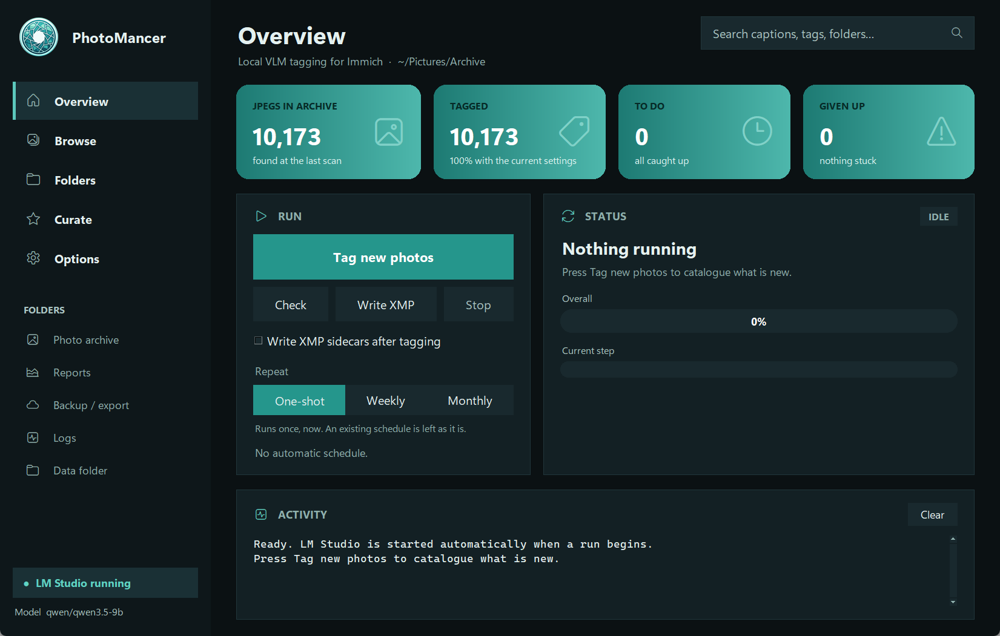

# PhotoMancer

**Tag a whole photo archive with a local vision model — genres, subjects, captions,
keywords, colours — written into standard XMP sidecars that Immich and digiKam
read. Search by meaning, find the folders about a topic, and let the model
curate your best shots. Nothing leaves your computer.**

PhotoMancer scans your JPEG archive, looks at every photo with a vision-language model
running in [LM Studio](https://lmstudio.ai) on your own GPU, and stores what it sees in
a local catalogue: a genre and subgenre from a fixed taxonomy, a one-sentence caption,
keywords, people and animals, setting, time of day, weather, season, techniques and
dominant colours. It then writes `photo.jpg.xmp` sidecars next to your photos — your
JPEGs are never modified.

Sibling app: [BiblioMancer](https://github.com/matteomarchionni/bibliomancer) does the
same for a library of scientific papers, with the same panel.



## Features

- **Incremental tagging** — only new or changed photos are processed; moved or duplicated
  files are recognised by content. Every result is saved as it lands, so a stop or a
  reboot loses nothing. ~20–28 photos per minute on a 12 GB GPU with `qwen/qwen3.5-9b`.
- **XMP sidecars** — hierarchical tags under one `AI` root (`AI|Genre|Landscape|Mountain`,
  `AI|Color|Blue`, `AI|Keyword|alps`…), flat keywords and a caption. Sidecars written by
  other programs, or edited since, are never overwritten.
- **Browse** — search *by meaning* ("foggy forest", "people at a wedding"), filter by
  genre, confidence or failures, and see exactly the tags that go into the sidecar.
- **Folders** — rank folders (or years, or albums) by how well their photos match a search.
- **Curate** — give a theme ("misty mountains at dawn"): search picks the candidates, the
  model rates each one for fit and quality, and the best become a contact sheet with the
  list of paths.
- **Report** — statistics, EXIF-vs-model disagreements, a CSV of the whole catalogue and
  a contact sheet per genre.
- **Export for AI agents** — the catalogue as Markdown, JSONL and SQLite (full-text), so
  Claude or ChatGPT can answer "find my foggy mountain shots from 2019".
- **Backup** — catalogue, settings and code copied to a synced folder after every run.
- **Configurable** — your own taxonomy (`taxonomy.yaml`), prompt, model and image size;
  results are stored per configuration and never mixed.
- **Runs everywhere** — Windows, macOS and Linux; installers for all three (macOS and Linux: experimental).

## Requirements

- [LM Studio](https://lmstudio.ai) with a **vision** chat model (default
  `qwen/qwen3.5-9b`) and the embedding model `nomic-embed-text-v1.5`.
- A GPU with ~8–12 GB of memory is comfortable for the default model.
- About 1 GB of local disk per 5,000 photos for previews and the catalogue.
- To run from source: Python 3.10+.

## Install

**Installers** (no Python needed): download the latest release from the
[Releases page](https://github.com/matteomarchionni/photomancer/releases):

| System | File | Notes |
|---|---|---|
| Windows | `PhotoMancer-<version>-Setup.exe` | per-user install, no admin rights; optional desktop / Start-menu shortcuts |
| macOS *(experimental)* | `PhotoMancer-<version>-macos-arm64.dmg` / `-x86_64.dmg` | drag to Applications; unsigned: first launch with right-click → Open |
| Linux *(experimental)* | `PhotoMancer-<version>-x86_64.AppImage` | `chmod +x` and run; the first-run window offers a menu entry |

> **macOS and Linux builds are experimental**: they are built automatically but have
> not been tested on real machines yet. Please report problems in the issues; running
> from Python (below) works everywhere.

**With Python** (any system):

```
pipx install git+https://github.com/matteomarchionni/photomancer
photomancer                   # opens the panel (first run: a short setup window)
photomancer shortcuts --menu --desktop
```

**From source**:

```
git clone https://github.com/matteomarchionni/photomancer
cd photomancer
python -m pip install -e .
python PhotoMancer.pyw        # or PhotoMancer.cmd on Windows
```

## Quick start

1. Start LM Studio once and download the models (the setup window checks and links them).
2. Open PhotoMancer. On first run it asks for your **photo archive**, a local **data
   folder** and, optionally, a **synced backup folder**.
3. Press **Check** to see what a run would do, then **Tag new photos**.
4. When you are happy with the results, press **Write XMP** (or tick *Write XMP sidecars
   after tagging*), then let Immich or digiKam read the sidecars.

The [tutorials](docs/tutorials/) walk through every page step by step.

## Documentation

| | |
|---|---|
| [Tutorials](docs/tutorials/) | installation, tagging, XMP and Immich, search, curate, scheduling, customisation, agents |
| [Configuration](docs/configuration.md) | every setting in `config.yaml`, and the taxonomy |
| [Command line](docs/command-line.md) | every panel button is a command too |
| [Troubleshooting](docs/troubleshooting.md) | common problems and fixes |
| [Packaging](packaging/README.md) | how the installers are built |

## How it works

```
JPEG archive ──► scan (hash, moves, duplicates) ──► prepare (EXIF, 1024 px preview,
      │                                                colours, perceptual hash)
      │                                                         │
      │                        local vision model (LM Studio) ◄─┘  structured JSON,
      │                                   │                         validated against
      ▼                                   ▼                         the taxonomy
 photo.jpg.xmp  ◄──────────  SQLite catalogue (per configuration)
                                          │
                  embeddings ──► Browse / Folders / Curate      export + backup
```

Everything runs on your machine; the only network traffic is to LM Studio on
`127.0.0.1`. The archive is only read — the sidecars are the only files written next
to your photos, and **Remove AI sidecars** deletes exactly those again.

## Development

```
python -m pip install -e ".[test]"
python -m pytest -q
```

The control-panel frame, theme, scheduler, LM Studio client and installer tooling are
shared with BiblioMancer: `src/photomancer/_shared/` is kept byte-identical in both
repositories with `python tools/sync_shared.py push` (a test fails if it drifts).

## License

[MIT](LICENSE) © 2026 Matteo Marchionni
